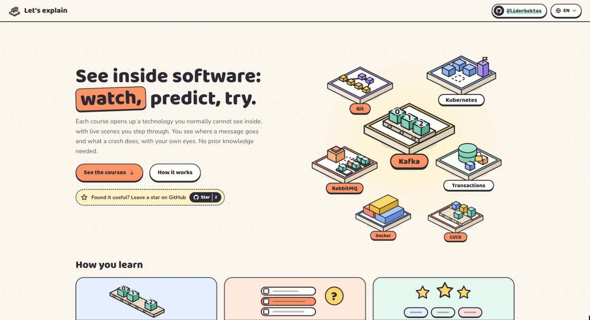
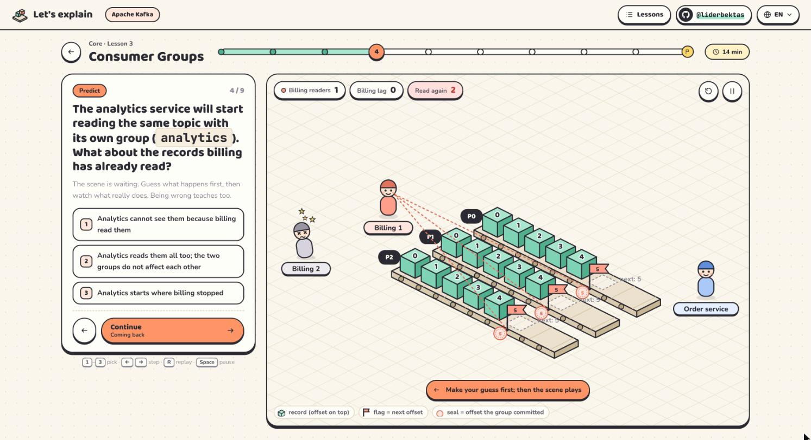
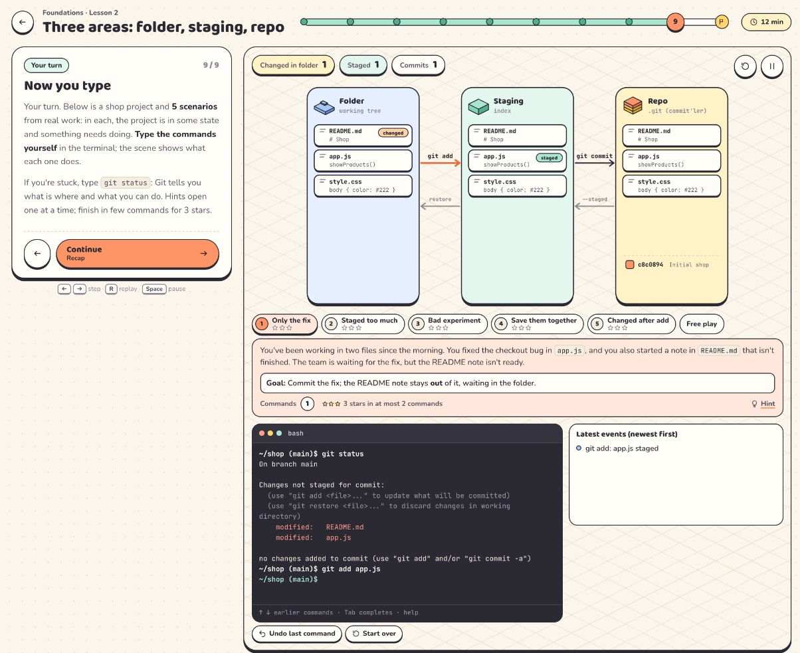
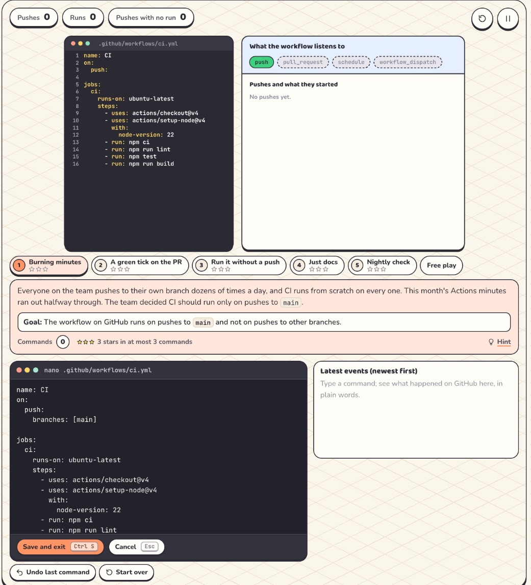
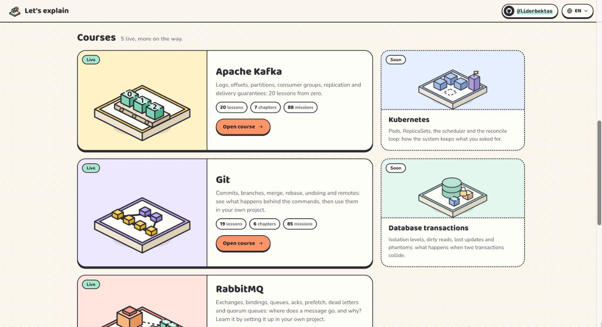

<div align="center">


# Let's explain

**See inside software: watch, predict, try.**

Interactive courses that open up the technologies you normally cannot see inside.
Live scenes you step through, guesses before the answer, and real-work scenarios
where you type the commands yourself.

[**letsexplain.co**](https://letsexplain.co) · Türkçe & English · Free

[](https://letsexplain.co)


<br />

<a href="https://letsexplain.co"></a>

</div>

---

## Why

Most people learn Kafka, Git or Docker by reading about them and copying commands. What actually
happens inside, where a message goes, what a rebase copies, why a container exited with 137, stays
invisible. Let's explain draws it: every lesson is a small, faithful simulation you step through,
and every lesson ends with you typing the real commands to solve a real problem.

## How a lesson works

### 1 · Watch

Each step plays one moment on an isometric stage: records landing on partitions, commits being
copied, a queue filling up. Nothing moves that does not move in the real system.

### 2 · Predict

On some steps the scene stops and asks you first. You guess, then watch what really happens.
Being wrong is part of it.

<p align="center">
  
</p>

### 3 · Try: real-work scenarios, typed by you

Every lesson ends with 4–5 scenarios from real work: *"you fixed the bug but the README note is not
ready, commit only the fix"*, *"push was rejected because a teammate pushed first"*, *"CI burns
minutes on every branch, run it only on main"*. You type the commands in a terminal; the scene
shows what each one does.

<p align="center">
  
</p>

- **The output is the real tool's output.** `git status`, `docker build`, `kafka-consumer-groups.sh --describe`
  and GitHub's workflow errors print what the real tools print.
- **The check looks at the result, not the words.** `git restore --staged`, `git reset` and
  `git rm --cached` all count when they leave the project in the right state.
- **Hints open one at a time**, from a nudge to the command name to the answer. Few commands earn
  three stars; looking at the answer leaves one.
- **Files are edited in place.** `nano` opens Dockerfiles, `compose.yaml`, workflow YAML, Python
  code and properties files, and `git commit` without `-m` opens the message editor, as it does
  on your machine.

<p align="center">
  
</p>

## Courses

<p align="center">
  
</p>

| Course | Lessons | What you type in the scenarios |
|---|---|---|
| **Git** | 19 in 6 chapters | `git` itself: status, add, commit, branch, merge, rebase and `rebase -i`, reset, revert, stash, cherry-pick, reflog, bisect, push and pull |
| **Apache Kafka** | 20 in 7 chapters | `kafka-topics.sh`, the console producer and consumer, `kafka-consumer-groups.sh` with real lag, `kafka-configs.sh`, KRaft tools; `producer.properties`, connectors and schemas for the code-side lessons |
| **RabbitMQ** | 17 in 5 chapters | Python (pika) code you edit and run, background workers, `rabbitmqctl` for queues, bindings and policies, and cluster nodes you stop and start |
| **Docker** | 22 in 8 chapters | `docker run` and friends, Dockerfiles you write and build, `docker compose`, registries, and a first look at `kubectl` |
| **CI/CD** | 24 in 8 chapters | GitHub Actions workflows written in YAML, `git push`, `gh pr`, `gh run view --log-failed`, secrets, environments and deploy strategies |
| **WebSocket** | 16 in 7 chapters | `curl` for polling, SSE and handshakes by hand, `wscat`, `openssl` for the accept, `printf` and `xxd` for raw frames, Node servers you edit and restart, `tshark` captures, nginx config, `iptables` to cut the network, and `redis-cli` across several servers |
| Kubernetes, database transactions | Planned | |

Every course is available in Turkish and English, and needs no prior knowledge.

## Faithful by design

- **Real mechanisms, small scale.** Each course runs on a small, deterministic model of the real
  system: Git objects with the ids real Git would give them, Kafka partitions with offsets and
  consumer-group commits, a RabbitMQ broker with exchanges, acks, dead letters and quorum queues,
  Docker images with a layer cache, a GitHub Actions runner with fresh machines.
- **Honest about limits.** Where the model simplifies, the lesson says so in an *In reality* note,
  and a command the sandbox does not support says so plainly instead of pretending.
- **Tested.** About 2,400 tests check the models, the command lines, and every scenario: the start
  state is not already solved, the intended commands win in exactly par, real alternatives also win,
  and a tempting wrong move does not.

## Running it locally

```bash
npm install
npm run dev        # http://localhost:5173
npm test           # models, command lines and scenarios
npm run build      # static site in dist/
```

The build is plain static files with path routes (`/kafka/consumer-groups/4`). Any static host
works as long as unknown paths serve `index.html`; on nginx that is
`try_files $uri $uri/ /index.html;`. The build also writes a `404.html` copy for hosts such as
GitHub Pages.

## Project layout

```text
packages/core/       shared by every course
  components/        lesson player, predictions, scenario panel, terminal, recap and quiz
  course/            Course, Lesson and Scenario types
  iso/               isometric drawing pieces (boxes, belts, characters, buildings)
  i18n/              TR/EN text helpers
  lib/               routing, progress storage, playback, smooth scrolling
courses/<course>/
  engine/            the course's model, and cli.ts: the command line on top of it
  iso/               the course's stages
  lessons/<slug>/    one folder per lesson
site/                the hub listing every course, and the app shell
```

Courses never import each other; they all build on `@lets-explain/core`. Progress and stars stay
in the browser, under separate keys per course.

## Writing a lesson

Inside `courses/<course>/src/lessons/<slug>/`:

| File | What it holds |
|---|---|
| `lesson.ts` | The steps (TR + EN), predictions, the "In your project" commands, recap and quiz |
| `Scene.tsx` | The scene for each step; the last step is the terminal with the scenarios |
| `scenarios.ts` | Each scenario's story, goal, start state, hints, par, and a check on the resulting state |
| `scenarios.test.ts` | The intended commands win in exactly par, real alternatives win, a tempting wrong move fails |

Lesson text supports `**bold**`, `` `code` ``, `[[term]]` and `[[term|shown text]]`.

## Adding a course

1. Export a `Course` from `courses/<course>/src/index.ts`: name, tagline, chapters, glossary and a
   home-page scene.
2. Give it a model in `engine/` and a command line (`run`, `prompt`, `complete`) that the shared
   terminal can drive through `useTypedSandbox`.
3. Add the `@lets-explain/<course>` alias to `tsconfig.json` and `vite.config.ts`, and list the
   course in `site/src/catalog.ts`.

## Feedback

Spotted something that does not match the real tool? Please [open an issue](https://github.com/liderbektas/lets-explain/issues).
If the courses helped you, a ⭐ on the repo helps others find them.

<div align="center">
<br />
Made by <a href="https://github.com/liderbektas">@liderbektas</a>
</div>
